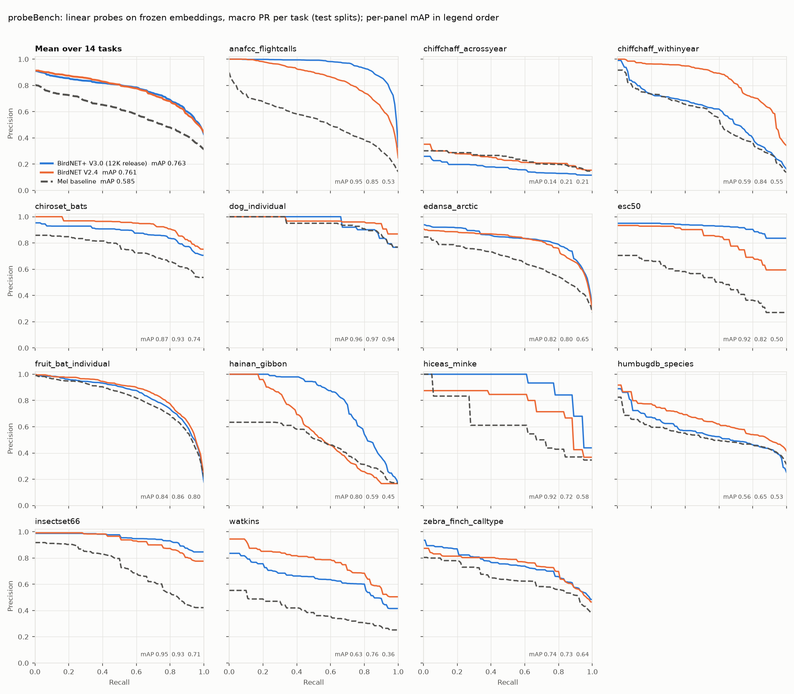

# probeBench

<p align="center">
  <br>
  <a href="LICENSE.md"></a>
  <a href="https://www.python.org/downloads/"></a>
  <a href="https://github.com/birdnet-team/probeBench/actions/workflows/ci.yml"></a>
  
</p>

A linear-probe benchmark for bioacoustic audio embeddings. It measures how well a
frozen embedding model transfers to tasks it was not trained for: marine mammals,
bats, insects, individual animals, call types, soundscape tags and environmental
sounds, 15 tasks from public datasets. In the spirit of
[BEANS](https://github.com/earthspecies/beans), but with grouped splits throughout
(no recording, session, site or individual spans train and test), ultrasonic tasks
made usable for 24-48 kHz models by time expansion, and a design that makes adding
a model or a task a single small file.

probeBench downloads and prepares the data, downloads the models on first use,
embeds every clip, fits one probe per task and reports the results.

## The recipe

One fixed recipe for every model and task:

1. Each clip is loaded at the model's sample rate (time-expanded first where the
   task says so) and cut into windows of the model's input length with a hop of
   half a window; a clip shorter than a window is centered and zero-padded.
2. Every window is embedded; the window embeddings are pooled per clip (mean and
   max, concatenated).
3. Features are standardized on the training split, and a class-balanced logistic
   regression (one-vs-rest for multi-label tasks) is fit for each C in
   {0.001, 0.01, 0.1, 1, 10}; C is chosen on the validation split by the task's
   headline metric.
4. The probe is refit on train + val with that C and scored once on the test split.

## Install

Python 3.11 or newer and the system library libsndfile
(`apt-get install libsndfile1` / `brew install libsndfile`).

```sh
git clone https://github.com/birdnet-team/probeBench.git
cd probeBench
pip install -e ".[birdnet]"      # BirdNET V3.0 (ONNX, no TensorFlow)
pip install -e ".[birdnet-tf]"   # adds TensorFlow for BirdNET V2.4
```

## Quickstart

```sh
# 1. Download and prepare two small tasks (about 1.5 GB) and fetch the model
probebench setup --tasks esc50 watkins --models birdnet-v3.0

# 2. Probe the model, then the mel baseline for reference
probebench run --model birdnet-v3.0 --tasks esc50 watkins
probebench run --model mel --tasks esc50 watkins

# 3. Compare
probebench report
probebench plot --out pr.png
```

`probebench run --model birdnet-v3.0` without `--tasks` runs the whole benchmark.
Missing tasks are downloaded and prepared first (about 52 GB of downloads for all
15 tasks; archives are deleted after their extraction is verified, use
`--keep-archives` to keep them). `probebench tasks` shows what is downloaded and
prepared.

All data goes under one root: `--data <dir>`, else `$PROBEBENCH_DATA`, else
`./data`. BirdNET models are cached by the `birdnet` package (`$BIRDNET_APP_DATA`).

## Results

Headline metric per task on the test split (accuracy, macro-F1, macro mAP or AUC;
higher is better). The mean is over the 14 tasks all three models have.

| Task | Metric | BirdNET+ V3.0 (12K release) | BirdNET V2.4 | Mel baseline |
|---|---|---:|---:|---:|
| anafcc_flightcalls | macro_f1 | 0.901 | 0.767 | 0.486 |
| chiffchaff_acrossyear | accuracy | 0.105 | 0.175 | 0.175 |
| chiffchaff_withinyear | accuracy | 0.623 | 0.685 | 0.492 |
| chiroset_bats | macro_f1 | 0.769 | 0.835 | 0.647 |
| dog_individual | accuracy | 0.914 | 0.957 | 0.862 |
| edansa_arctic | map | 0.818 | 0.800 | 0.653 |
| esc50 | accuracy | 0.880 | 0.809 | 0.453 |
| fruit_bat_individual | accuracy | 0.758 | 0.790 | 0.735 |
| hainan_gibbon | auc | 0.909 | 0.766 | 0.801 |
| hiceas_minke | auc | 0.978 | 0.946 | 0.892 |
| humbugdb_species | map | 0.560 | 0.646 | 0.525 |
| insectset66 | accuracy | 0.923 | 0.883 | 0.640 |
| right_whale_upcall | auc | - | 0.913 | 0.897 |
| watkins | accuracy | 0.613 | 0.648 | 0.402 |
| zebra_finch_calltype | macro_f1 | 0.649 | 0.658 | 0.559 |
| **Mean (14 tasks)** | | **0.743** | **0.740** | **0.595** |



The per-task numbers, chosen C values and split sizes are in [`results/`](results/).

**Which models these are.** The BirdNET+ V3.0 column is the V3.0 Global 12K release
(TorchScript, embedding = its second output), run with `torchscript:<file.pt>`. The
`birdnet-v3.0` spec uses whatever the `birdnet` package serves as "3.0"; with
birdnet 1.4 that is BirdNET+ V3.0-preview3.1 (11K classes), a different checkpoint
whose numbers differ from the 12K column. Every results file records the model it
came from. BirdNET V2.4 was run from its SavedModel (`embeddings` signature, 1,024
values); `birdnet-v2.4` loads V2.4 through the package (its TFLite build), whose
numbers can differ slightly from the SavedModel run.

V3.0 and V2.4 tie on average with different strengths: V3.0 leads on general and
soundscape sounds (ESC-50, EDANSA, gibbons, minke whales, insects) and flight calls;
V2.4 leads on fine-grained individual and vocal tasks (dogs, chiffchaffs, bats,
mosquitoes, marine mammal species).

## Tasks

| Task | Kind | Metric | What | Split grouped by | Download |
|---|---|---|---|---|---:|
| watkins | multiclass | accuracy | Marine mammal species (Watkins "best of" cuts, via BEANS) | tape | 0.9 GB |
| dog_individual | multiclass | accuracy | Which of 10 dogs barks (Yin & McCowan 2004, via BEANS) | session | 0.9 GB |
| hiceas_minke | detection | auc | Minke whale boing in a 1 min HICEAS recording (via BEANS) | recorder + day | 1.4 GB |
| fruit_bat_individual | multiclass | accuracy | Which Egyptian fruit bat calls (Prat et al. 2017, via BEANS), x10 | blocks of file ids | 5.2 GB |
| zebra_finch_calltype | multiclass | macro_f1 | Zebra finch call type (Elie & Theunissen 2016) | bird | 0.2 GB |
| humbugdb_species | multiclass | map | Mosquito species in flight (HumBugDB) | place + day | 4.1 GB |
| insectset66 | multiclass | accuracy | Orthoptera and cicada species (InsectSet66) | source recording (official) | 5.2 GB |
| chiffchaff_withinyear | multiclass | accuracy | Which chiffchaff male calls, same season (Stowell et al. 2019) | official lists | 2.7 GB |
| chiffchaff_acrossyear | multiclass | accuracy | Same, tested in a later season | official lists | (shared) |
| anafcc_flightcalls | multiclass | macro_f1 | Night flight-call species (BirdVox-ANAFCC) | unit + time block | 5.7 GB |
| edansa_arctic | multilabel | map | Arctic soundscape tags (EDANSA-2019) | site (official) | 7.9 GB |
| hainan_gibbon | detection | auc | Hainan gibbon call in a 10 s window (Dufourq et al. 2021) | recording | 11.9 GB |
| chiroset_bats | multiclass | macro_f1 | European bat species (ChirosetEurope), x10 | source + place + date (official) | 9.6 GB |
| esc50 | multiclass | accuracy | Environmental sound class (ESC-50) | official folds | 0.6 GB |
| right_whale_upcall | detection | auc | Right-whale upcall in a 2 s clip (Cornell challenge, MONSTER) | none (no ids in the data) | 0.5 GB |

x10: ultrasonic recordings are time-expanded tenfold on load (the native sample
rate is divided by 10), so 20-120 kHz calls land at 2-12 kHz and a 5 ms call lasts
50 ms. Results on these tasks measure how well an embedding transfers to
spectro-temporal patterns it never heard at that scale, not ultrasonic hearing.

Each task's `task.json` records its source, license and citation. Details that
shape the numbers:

- ESC-50 drops the 680 clips whose Freesound source recording is also in FSD50K or
  UrbanSound8K, which many audio models train on (list:
  `src/probebench/datasets/esc50_excluded.txt`).
- BirdVox-ANAFCC uses the BirdVox-70k, CLO and Old Bird clips only (the dataset's
  Xeno-canto and Macaulay files are not downloaded) and at most 1,500 clips per
  species.
- ChirosetEurope uses the recordings in the dataset's own `audio.zip`; its link-only
  rows (recordings hosted on other platforms) are not fetched.
- HumBugDB's headline metric is mAP: under the place/day split macro-F1 caps near
  0.5 for every model.
- Licenses differ per dataset; several are non-commercial or academic-use only. The
  code here only downloads from the original hosts.

## Adding a model

A model adapter is any object with `name`, `sample_rate`, `window_s` and
`embed(x)`, mapping float32 windows `[N, samples]` to embeddings `[N, D]`:

```python
# my_model.py
import numpy as np


class MyModel:
    name = "my_model"
    sample_rate = 32000
    window_s = 3.0

    def __init__(self):
        self.net = ...  # load or download weights here

    def embed(self, x: np.ndarray) -> np.ndarray:
        return self.net(x)


def make():
    return MyModel()
```

```sh
probebench run --model py:my_model:make
```

To give it a short name inside the package, decorate the factory with
`@register("my-model")` in a module under `src/probebench/models/` (see `mel.py`)
and import that module in `models/__init__.py`. TorchScript files that take raw audio
and return `(scores, embeddings)` work as they are:
`--model torchscript:model.pt@my_name`.

## Adding a task

Add a module under `src/probebench/datasets/` with a `DATASETS` list (download
locations and a `prepare(raw_dir, tasks_root)` function that writes `task.json` and
`manifest.parquet` through `write_task`) and list it in `datasets/__init__.py`. The
task format is documented in `src/probebench/tasks.py`; `datasets/esc50.py` is a
short example. Use grouped splits (`grouped_split`, `per_class_group_split`) so no
recording, session or individual spans train and test.

## Data layout

```text
<data>/raw/<dataset>/             downloads; archives extracted to extracted/
<data>/tasks/<task>/task.json     kind, metric, time expansion, source, license, citation
<data>/tasks/<task>/manifest.parquet  clip_id, path, start_s, end_s, label, split, group
<data>/cache/<model>/<task>.npz   pooled clip embeddings (reused across runs)
<data>/results/<model>.json       per task: headline, all test metrics, chosen C, split sizes
<data>/scores/<model>/<task>.npz  test scores and labels (for the PR figure)
```

## License

- **Source code and published results**: [MIT License](LICENSE.md)
- **Datasets**: not part of this repository; probeBench downloads them from their
  original hosts, and each keeps its own license, recorded in its task's `task.json`.
  Several are non-commercial or academic-use only.
- **Models**: each evaluated model keeps its own license (for BirdNET, see the
  [`birdnet` package](https://github.com/birdnet-team/birdnet)).

## Citation

If you use probeBench, please cite it using [CITATION.cff](CITATION.cff) and cite
the datasets behind the tasks you report (each task's `task.json` lists its citation).

## Contributing

See [CONTRIBUTING.md](CONTRIBUTING.md) for guidelines. New models and tasks are
welcome; AI-assisted contributions too, keep PRs focused and review every line.

## Acceptable Use

BirdNET is built to support biodiversity research and conservation. See
[ACCEPTABLE_USE.md](ACCEPTABLE_USE.md) for how we expect the code to be used,
including uses we consider unacceptable and guidance on branding derivative work.

## Funding

Our work in the Cornell K. Lisa Yang Center for Conservation Bioacoustics is made possible by the generosity of K. Lisa Yang to advance innovative conservation technologies to inspire and inform the conservation of wildlife and habitats.

The development of BirdNET is supported by the German Federal Ministry of Research, Technology and Space (FKZ 01|S22072), the German Federal Ministry for the Environment, Climate Action, Nature Conservation and Nuclear Safety (FKZ 67KI31040E), the German Federal Ministry of Economic Affairs and Energy (FKZ 16KN095550), the Deutsche Bundesstiftung Umwelt (project 39263/01) and the European Social Fund.

## Partners

BirdNET is a joint effort of partners from academia and industry.
Without these partnerships, this project would not have been possible.
Thank you!


